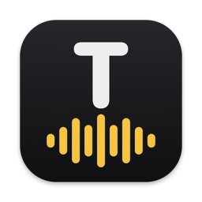
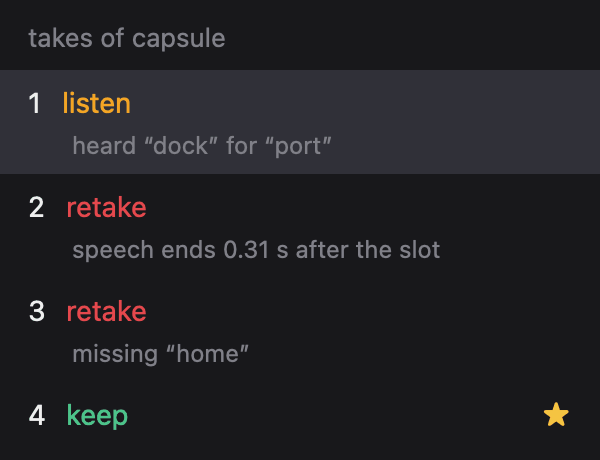

<p align="center"></p>

<h1 align="center">Takewise</h1>

<p align="center"><strong>A Mac app for narrating a finished film:</strong> read from a teleprompter timed to your cut, catch likely mistakes while you're still at the mic, and bring one synced narration file back into your editor.</p>

<p align="center">macOS 14+ · Apple Silicon · local after a one-time model download · signed and notarized · Homebrew · <a href="LICENSE">MIT</a> · <a href="#install">Install</a></p>


<sub>Two takes of one line at twice their speed: the first comes back `retake · missing “home”`, the second `keep` with a hollow star (proposed), and Enter chooses it. Demo film: NASA's public-domain "Earth Views from the International Space Station". The takes are spoken by macOS `say` and checked by Takewise's real checks; `mise run screenshots` renders every image here offscreen ([how](docs/reference.md#regenerating-the-screenshots)).</sub>

## Why

Narration over a finished cut usually goes into a recorder app, Audition or a phone: one long file, no picture in front of you, the script on another screen. Afterwards you scrub through it for the good take of each line and spot each one onto the timeline by hand. Recording inside the editor gives you the picture, but the script and the retakes still have nowhere to go. Either way the mistakes surface late: a wrong word you only hear while cutting, a line that runs into the next shot, a peak that clipped.

Takewise records one line at a time against the picture, keeps every take, checks each one while you're still at the mic, and hands back a file that already lines up with the film.

## How it works

Takewise is a recording window plus a `takewise` command for everything around it.

1. **Script.** `takewise init` starts a project from the finished film. The script is a small text file, `script.toml`: one entry per line, each with its start in film time. You write it, or an agent drafts it. Rough starts are fine: while a take plays, M moves the line's start to the playhead. A line's *slot* runs from its start to the next line's start (or to an end you set); it is the time the line has to fit in.
2. **Record to picture.** `takewise record` opens the window. Press Space: the film plays from just before the line, counts in, and the words fill at an even pace across the slot. Space again stops.
3. **Checks.** After each take, Takewise compares a local whisper.cpp transcript with the script and flags likely word, timing and sound problems: `keep`, `listen` or `retake`, with the reason. Listen back before choosing.
4. **Choose.** The best-ranked take gets a hollow star. Press Enter on the one you want; Takewise never chooses for you.
5. **Export.** `takewise export` writes one narration file exactly as long as the film. Put it at the start of the film's timeline in any editor and every line sits where you recorded it.

## Working with an agent

> *"My cut is `renders/promo.mp4` and the voiceover draft is in `notes.md`. Set up a Takewise project with each line timed to its shot. I'll record; then tell me which lines to redo, export, and put the narration on the Resolve timeline."*

Takewise splits the work: you stay at the mic, and an AI agent handles everything else through the `takewise` command (every state the window shows is also available as `--json`) and the project folder (plain TOML, JSONL and WAV).

- **It drafts the timed script.** For that it needs its own view of the cut, such as frames pulled with `ffmpeg` or the editor's timeline through its own tools; Takewise doesn't provide one.
- **It reads the checks** and tells you which lines to redo.
- **It judges and chooses**, if you hand that over: `judge` adds its verdict and reason, `choose` picks a take. Otherwise you choose in the window.
- **It exports**, and places the file in the edit with its own editor tools, using the manifest for markers or take-by-take placement.

```console
$ takewise status earth.takewise
earth.takewise  ·  film 60.0 s  ·  6 line(s)
orbit           1 take(s)  chosen 1 (narrator)   proposed 1  keep
coast           1 take(s)  chosen 1 (narrator)   proposed 1  keep
capsule         4 take(s)  chosen 4 (narrator)   proposed 4  keep
storm           1 take(s)  chosen –              proposed 1  keep
ocean           0 take(s)  chosen –              proposed –
desert          0 take(s)  chosen –              proposed –

$ takewise judge earth.takewise storm 1 --verdict keep --reason "clear, unhurried" --by claude-opus-5-5 --score 0.8
Judged storm take 1: keep
$ takewise choose earth.takewise storm 1 --by claude-opus-5-5
Chose storm take 1 (claude-opus-5-5)
$ takewise export earth.takewise
export refused:
lines without a chosen take: ocean, desert (no-choice)
```

The export refuses until every line has a chosen take: here, two lines still need recording. [docs/agents.md](docs/agents.md) is the agent's guide: the whole loop with the exact commands and JSON. A test runs every command in it.

## What it does

### Reading to picture


<sub>A fifth take of the capsule line, the pace guide at “port,”. On the right, the line's earlier takes and why each got its verdict.</sub>

The window shows the film, the line to read, its note for the narrator and the next line. A bar shows the slot running out, and a long line scrolls with the pace guide. E fixes a line's wording in place.

### Every take checked

<table align="right"><tr><td><br><sub>The capsule line's takes, take 4 chosen.</sub></td></tr></table>

After each take, on your Mac:

- **Words.** whisper.cpp transcribes the take without being shown the script, so it doesn't hear what it expects. Missing or extra words give `retake`. A word heard differently, such as “dock” for “port”, gives `listen`, because names and numbers are often misheard.
- **Timing.** Speech that ends more than 0.25 s after the slot, or starts more than 0.3 s before the line, gives `retake`.
- **Sound.** No speech or clipped samples give `retake`. A cough or another sound inside the speech, or a voice less than 30 dB above the take's background noise, gives `listen`.

The first finding is the reason shown under the take. These are automated checks with limits: P plays the line in context, the take locked to the film, so you can listen before you choose. The word checks default to English; `[check] language` in `project.toml` takes any Whisper language code, but the matching of numbers and contractions is tuned for English. Until the speech model is installed, takes get `listen` ("words not checked") while timing and sound can still give `retake`, and their words are checked once it is there.

<br clear="right">

### Pick the microphone, watch the level

<table align="right"><tr><td><br><sub>The audio panel, and a peak near clipping.</sub></td></tr></table>

Press A for the audio panel. Pick the input and the channel your microphone is on: every channel has its own meter, so the one that moves is yours. Then pick the output the film plays through and set the film's volume. The input meter shows a target band and a near-clipping light that stays red until you clear it with K.

Takewise records at 48 kHz from an input running at that rate. For an input set to another rate, the panel offers **Switch to 48 kHz**.

<br clear="right">

### A setup check before the first take


<sub>The setup check's voice and room steps, each with its result.</sub>

Press C, and Takewise walks you through your devices, flagging speakers and Bluetooth headphones. Then it listens while you read a sentence and tells you how far to turn the gain on your interface. Next it records five seconds of silence and rates how far your voice stands above the room's noise; that recording is kept as room tone for the export's noise reduction. When the latency hasn't been measured for these devices, a last step does it: hold your headphones against the microphone and press Space, and beeps play for about 15 seconds while Takewise measures where they land (`takewise calibrate --write` does the same from the command line).

### Export for your editor

`takewise export` takes each line's chosen take and writes `export/narration.wav` (or FLAC): one mono file that starts at the film's first frame, is exactly as long as the film and has every take at the sample position it was recorded at. Beside it, `export/manifest.json` lists each line's sample positions, words and timings, for an agent or script that adds markers or places takes one by one.

The default `clean` processing high-passes each take and reduces its noise when a matching room tone from the setup check exists. It then brings the narration to typical web and YouTube loudness (−16 LUFS) with peaks kept below −1 dBTP, and records the measured loudness and peak in the manifest. Very dynamic narration can stay below the target, because the limiter takes at most 6 dB; the export warns when that happens. Your takes themselves are never changed. If a line has no chosen take or two lines overlap, the export refuses and names the lines, so the mistake doesn't reach the edit.

## Status

0.1.0, the first release. It is tested with recorded narration, but end-to-end testing across audio interfaces is still limited. Not there yet:

- **Hearing your own voice through Takewise.** Use your interface's direct (hardware) monitoring.
- **Writing the script inside the app.** In the window, E edits a line's text and M its start; new lines go into `script.toml`.
- **Exporting from the window.** Export is the `takewise export` command.

If something doesn't work with your setup, please [open an issue](https://github.com/niklas-heer/takewise/issues).

## Install

```sh
brew install --cask niklas-heer/tap/takewise   # Takewise.app, the takewise command, whisper-cpp and ffmpeg
takewise models install                        # the speech model for the word checks (1.5 GB), once
takewise doctor                                # checks the tools, the model, the microphone and the devices
```

Takewise needs an Apple Silicon Mac with macOS 14 or later, and an audio input that runs at 48 kHz. The app is signed and notarized. The speech model (`ggml-large-v3-turbo.bin`) comes from whisper.cpp's repository on Hugging Face and is installed only when its SHA-256 matches the one pinned in Takewise; the recording window offers the same download with a button. After that, nothing needs the network.

The first take asks for microphone access. If you said no, turn Takewise on in System Settings › Privacy & Security › Microphone and reopen it.

## A first session

```sh
takewise init promo.takewise --film renders/promo.mp4   # a project for the finished film
$EDITOR promo.takewise/script.toml                      # the lines (or let an agent write them)
takewise record promo.takewise                          # the recording window
takewise export promo.takewise                          # export/narration.wav and export/manifest.json
```

Each line in `script.toml` is a `[[line]]` table; `end` and `note` are optional ([the whole format](docs/design.md#project-folder)):

```toml
[[line]]
id = "capsule"
start = 22.5
end = 26.6
text = "A capsule waits at its port, ready to bring the crew home."
note = "Calm. Let it land on “home”."
```

In the window: **A** to pick the microphone and output, **C** for the setup check, then **Space** to record a line and **Space** to stop. **R** records another take, **P** plays one in context, **Enter** chooses it, and **↓** moves to the next line.

### Keys

| Key | Does |
| --- | --- |
| Space | Record a take of the current line, or stop it |
| Enter | Choose the selected take |
| R | Record another take |
| P | Play the line in context, the take locked to the film |
| M | Set the line's start to the playhead while the film plays |
| E | Edit the line's text (Enter saves, Esc cancels) |
| ↑ / ↓ | Previous or next line |
| ← / → | Previous or next take |
| A | The audio panel: input, channel, output, volume, meters |
| C | The setup check |
| − / + | Film quieter or louder |
| K | Clear the clipping light |
| I | Install the speech model, while it is missing |

H and the monitor volume keys (`,` and `.`) belong to monitoring, which isn't available yet.

Opening `Takewise.app` from the Dock or Finder shows a start window: **Open project…** (⌘O) opens a `.takewise` folder, or asks for the finished film to start a project in any other folder. Recent projects are listed below it ([details](docs/reference.md#the-start-window)).

## Placing the narration

The narration file starts at the film's first frame and is exactly as long as the film. In any editor, put it on a mono track at the start of the film's timeline, so its sample 0 lines up with frame 0. Takewise has no editor-specific code. In DaVinci Resolve, for example, you or an agent with Resolve tools would:

1. Import the file named in the manifest's `narration.file` into the media pool.
2. Add a mono audio track to the film's timeline and place the file at the timeline's start.
3. Optionally add a marker for each entry under `lines` in `export/manifest.json`, at `speech_film_s[0]`, named after the line's `id`.

To place each take on its own instead, see [placing takes one by one](docs/agents.md#7-place-it-in-the-edit).

## Reference

- [docs/reference.md](docs/reference.md): every command and its options, exit codes and refusals, the export formats and processing, the audio panel, the setup check step by step, building from source, and how the screenshots are made.
- [docs/agents.md](docs/agents.md): an agent's full loop with the exact commands and JSON.
- [docs/design.md](docs/design.md): the design, the folder format and the reasons behind them.

### From source

With Rust (pinned in `rust-toolchain.toml`) and [mise](https://mise.jdx.dev): `mise run build`, `mise run check`, and `mise run bundle` for `build/Takewise.app`, which recording needs for the microphone permission. See [building from source](docs/reference.md#building-from-source) for the details, and [RELEASE.md](RELEASE.md) for releases.

## License

[MIT](LICENSE)
