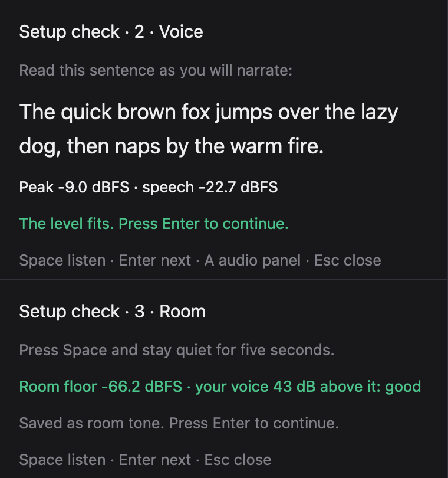
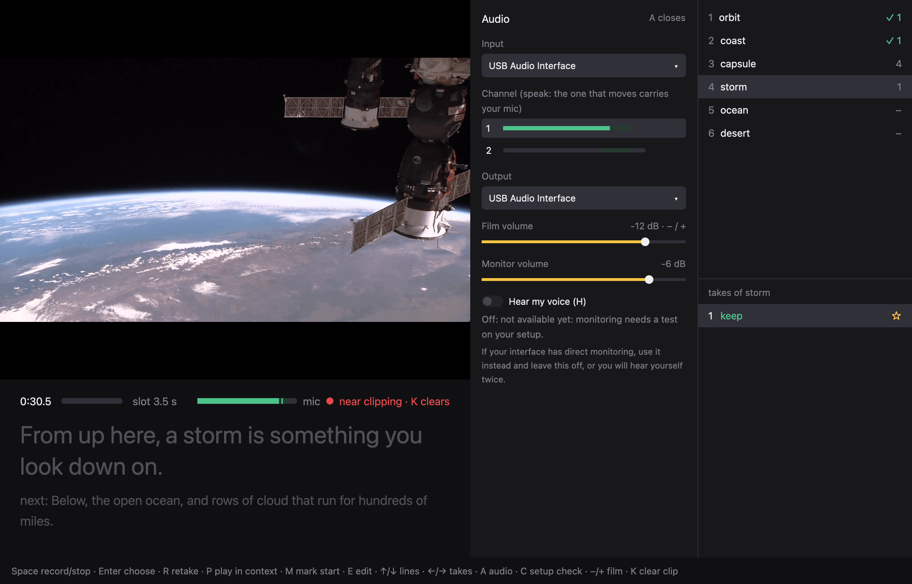

# Takewise

Record the voiceover for a finished film, line by line, and know right away which takes are good.


Takewise is a macOS app for anyone who narrates over a cut that is already done: a promo, a documentary, an explainer, a YouTube video. The script runs as a teleprompter timed to the picture. Every take of every line is kept and checked against the script, so a wrong word or a line that runs long shows up seconds after you said it, not later in the edit. When you are done, one command writes a single narration file exactly as long as the film, levelled and placed to the sample, with a manifest for DaVinci Resolve.

## Why

Recording narration inside an editor such as DaVinci Resolve means working against a tool built for something else. The track has to be armed and the microphone patched in a dialog; the script lives in marker notes you can't read while you speak; retakes pile up on the timeline and have to be sorted by ear. The mistakes surface later: a flubbed word you only notice while cutting, a line that runs into the next shot, a peak that clipped, a room that hums. Then the narration still needs levelling and noise cleanup.

Takewise takes that job out of the editor:

- **Read to picture.** The line to read is shown large under the film, with a count-in and a pace guide that fills the words across the line's slot.
- **Retake without bookkeeping.** Every take of every line is kept. Nothing is overwritten or deleted.
- **Know what you have.** Each take is checked for wrong and missing words, timing, clipping, stray sounds and background noise, and gets a verdict with the reason. The best take is proposed; you choose.
- **Start with a good sound.** A setup check gets the level, the room and the latency right before the first take.
- **Hand off one file.** The export is one narration file for the whole film at −16 LUFS, true peak below −1 dBTP, every take at its exact sample position.

Everything is local: recording and checking need no network, no account and no Resolve.

## How it works

1. **Script.** Start a project from the finished film and write the script: one line per sentence or phrase, each with its start in film time. You write it by hand, or an AI agent drafts it.
2. **Record to picture.** Press Space. The film plays from a little before the line, counts in, and the line fills at an even pace. Press Space again to stop.
3. **Checked takes.** Within seconds every take has a verdict: `keep`, `listen` or `retake`, with the reason, such as `missing “home”` or `speech ends 0.31 s after the slot`. Record as many as you like.
4. **Choose.** The top take is proposed with a hollow star. Press Enter on the one you want; Takewise never chooses for you.
5. **Export to Resolve.** `takewise export` writes the narration file and its manifest; put it on a track at the film's first frame and every line sits where it was recorded.

## What it does

### Reading to picture

The recording window shows the film, the line to read, its note for the narrator and the next line. Recording starts the film two seconds (`preroll_s`) before the line with a 3-2-1 count-in, and runs until you stop it or 1.5 s (`tail_s`) after the line's slot ends. The words fill from left to right at an even pace across the slot, a bar shows the slot running out, and a line longer than three rows scrolls with the pace guide, keeping the current words on the middle row. You can fix a line's wording in place (E) or set its start to the playhead while the film plays (M).

### Every take checked


After each take Takewise checks, on your Mac:

- **Words**, with whisper.cpp, which hears the take without being shown the script, so it does not hear what it expects. Missing and extra words give `retake`; a word heard differently, such as “dock” for “port”, gives `listen`, since names and numbers are often misheard.
- **Timing**: speech that ends more than 0.25 s after the line's slot, or starts more than 0.3 s before the line, gives `retake` with the amount.
- **Sound**: no speech or clipped samples give `retake`; a cough or another sound inside the speech, or a voice less than 30 dB above the take's own background noise, gives `listen`.

The first finding is the reason shown under the take. The takes of a line are ranked, the top one gets a hollow star (proposed), and the take you choose with Enter gets a filled one. P plays the line in context, the take locked to the film, so you can listen before you choose.

<br clear="right">

### A setup check before the first take



Press C and Takewise walks you through your devices, your voice and your room. It listens while you read a sentence and tells you how far to turn the gain on your interface; it records five seconds of silence and rates how far your voice stands above the room's noise, with tips when it is too close. It flags speakers and Bluetooth headphones, and asks for a latency calibration when the devices changed. The silence is kept as room tone for noise reduction in the export.

<br clear="right">

### Sound you can see



Press A for the audio panel: the input and the channel your microphone is on (each channel has its own meter, so the one that moves is yours), the output the film plays through, and the film and monitor volume. The input meter shows a target band and a near-clipping light that stays red until you clear it with K.

### Clean export for Resolve

`takewise export` uses each line's chosen take and writes `export/narration.wav` (or FLAC), mono, starting at the film's first frame and exactly as long as the film, with `export/manifest.json` listing every line's exact sample positions, its words and timings. The default `clean` processing high-passes each take, reduces its noise when a room tone from the setup check matches it, and brings the narration to −16 LUFS integrated with a transparent limiter that keeps the true peak below −1 dBTP. Takes themselves are never changed. The export refuses, naming the lines, when a line has no chosen take or two lines overlap, so a mistake does not reach the edit.

### Built for agents

Every step is also a command with JSON output, and the project is a plain folder of TOML, JSONL and WAV. An AI agent can run the whole loop around the narrator: draft `script.toml` from the cut, read every take's verdict, add its own judgment (`takewise judge`), choose takes, export, and place the narration in Resolve with the manifest. [docs/agents.md](docs/agents.md) walks through that loop with the exact commands and JSON shapes; a test runs every command in it.

```console
$ takewise status earth.takewise
earth.takewise  ·  film 60.0 s  ·  6 line(s)
orbit           1 take(s)  chosen 1 (narrator)   proposed 1  keep
coast           1 take(s)  chosen 1 (narrator)   proposed 1  keep
capsule         4 take(s)  chosen 4 (narrator)   proposed 4  keep
storm           1 take(s)  chosen –              proposed 1  keep
ocean           0 take(s)  chosen –              proposed –
desert          0 take(s)  chosen –              proposed –

$ takewise status earth.takewise --json | jq -c '.data.lines[] | select(.id == "capsule") | .takes[] | {take, effective, reason}'
{"take":1,"effective":"listen","reason":"heard “dock” for “port”"}
{"take":2,"effective":"retake","reason":"speech ends 0.31 s after the slot"}
{"take":3,"effective":"retake","reason":"missing “home”"}
{"take":4,"effective":"keep","reason":null}
```

## Install

```sh
brew install --cask niklas-heer/tap/takewise   # Takewise.app, the takewise command, whisper-cpp and ffmpeg
takewise models install                        # the speech model (1.5 GB), once
takewise doctor                                # check the tools, the model, the microphone and the devices
```

Takewise needs an Apple Silicon Mac with macOS 14 or later. The cask installs `Takewise.app`, links `takewise` onto your `PATH`, and pulls in `whisper-cpp` (for the word checks) and `ffmpeg` (film info, audio for the checks, `clean` export, FLAC and 44.1 kHz).

The speech model (`ggml-large-v3-turbo.bin`) is not bundled. `takewise models install` downloads it from whisper.cpp's repository on Hugging Face into `~/.local/share/takewise/models` (or `$TAKEWISE_MODELS`), resumes an interrupted download, and installs it only when its SHA-256 matches the one pinned in Takewise. The recording window offers the same with a button while the model is missing. Until it is installed, takes are checked without words (`listen`, "words not checked") and checked again once it is there.

The first take asks for the microphone. If you said no, the window says so and does not record: turn Takewise on in System Settings › Privacy & Security › Microphone and reopen it; `takewise doctor` reports the same.

Recording, choosing and `raw` WAV export at 48 kHz work without `whisper-cli` and `ffmpeg`.

## A first session

1. **Start a project** from the finished film and write the script, by hand or with an agent ([the agent guide](docs/agents.md)):

   ```sh
   takewise init promo.takewise --film renders/promo.mp4
   $EDITOR promo.takewise/script.toml
   ```

   Each line is a `[[line]]` table with an `id`, the `start` in seconds of film time, an optional `end`, the `text` and an optional `note`:

   ```toml
   [[line]]
   id = "capsule"
   start = 22.5
   end = 26.6
   text = "A capsule waits at its port, ready to bring the crew home."
   note = "Calm. Let it land on “home”."
   ```

   See [Project folder](docs/design.md#project-folder) for the whole format.

2. **Open the recording window** with `takewise record promo.takewise`. Press **A** to pick the microphone's input and channel and the headphones' output, then **C** for [the setup check](docs/reference.md#the-setup-check): your level, the room's noise and the latency. Run `takewise calibrate promo.takewise --write` once per device pair when it asks.

3. **Record.** Space starts a take of the current line: the film plays from a little before the line, counts in, and the line fills at an even pace across its slot. Space again stops. Every take is kept and checked: words, timing and sound, with a verdict (`keep`, `listen`, `retake`) in the take list. Record more takes with R, listen with P, and press Enter on the take you want.

4. **Export** with `takewise export promo.takewise`: `export/narration.wav`, as long as the film, and `export/manifest.json`. Place it in your edit as described [below](#placing-the-narration-in-davinci-resolve).

### Keys

| Key | Does |
| --- | --- |
| Space | Record a take of the current line, or stop it |
| Enter | Choose the selected take |
| R | Record another take |
| P | Play the line in context, the take locked to the film |
| M | Set the line's start to the playhead while the film plays |
| E | Edit the line's text (Enter saves, Esc cancels) |
| ↑ / ↓ | Previous or next line |
| ← / → | Previous or next take |
| A | The audio panel: input, channel, output, volumes, meters |
| C | The setup check |
| − / + | Film quieter or louder |
| , / . | Monitor quieter or louder |
| H | Monitoring (not available yet) |
| K | Clear the clipping light |
| I | Install the speech model, while it is missing |

Monitoring your own voice through Takewise is not available yet: it waits for a test on a real interface with wired headphones. If your interface has direct (hardware) monitoring, use that to hear yourself.

### The start window

Opening `Takewise.app` from the Dock or Finder shows the start window. **Open project…** (⌘O) opens a `.takewise` folder; any other folder asks for the finished film and starts a project there (in a new `<film>.takewise` folder inside it, unless the folder is empty or named `….takewise`). If that `<film>.takewise` project exists already for this film, it opens; if it belongs to another film of the same name, the new project is named after the film's full file name (`Promo.mov.takewise`). Recent projects are listed below; a project that is already open comes to the front instead of opening twice.

## Placing the narration in DaVinci Resolve

The narration file (`export/narration.wav` or `.flac`, mono, at the manifest's `sample_rate` and `bit_depth`) starts at the film's first frame and is exactly as long as the film. Takewise has no Resolve code; you, or an agent with Resolve tools, place it:

1. Import the narration file named in the manifest's `narration.file` into the media pool.
2. Add a new mono audio track to the film's timeline and place it at the timeline's start (the film's first frame), so sample 0 lines up with frame 0.
3. For each entry in `export/manifest.json` under `lines`, add a timeline marker at `speech_film_s[0]` with the line's `id` as its name and `text` as its note.

To place takes individually instead, put each line's `take_file` (always the raw original at 48 kHz) on the track at `dest_samples[0] / sample_rate` seconds and trim it to `source_samples` (take samples at `source_sample_rate`, 48 kHz); the positions in the manifest are exact sample offsets.

## Reference

- [docs/reference.md](docs/reference.md): every command and its options, exit codes and refusals, the export formats and processing, the audio panel and meters, the setup check step by step, and how the screenshots are made.
- [docs/agents.md](docs/agents.md): an agent's full loop with the exact commands and JSON.
- [docs/design.md](docs/design.md): the design, the folder format and the reasons behind them.

### From source

With Rust (pinned in `rust-toolchain.toml`) and [mise](https://mise.jdx.dev): `mise run build`, `mise run run -- <command>`, `mise run check`. Recording runs inside `Takewise.app`, so the microphone permission belongs to Takewise rather than to the terminal that started it: build the bundle with `mise run bundle` (a release build in `build/Takewise.app`, signed ad hoc, so macOS asks for the microphone again after each rebuild; set `TAKEWISE_SIGN_IDENTITY` to a Developer ID to keep the grant). `takewise record` looks for the bundle it runs in, then `$TAKEWISE_APP`, then `/Applications/Takewise.app`, then the repository's `build/Takewise.app`. Without Homebrew, **Takewise › Install Command Line Tool…** in the app links `~/.local/bin/takewise` to the binary inside the bundle; it never replaces a file that is not a link to a Takewise bundle. Releases are described in [RELEASE.md](RELEASE.md).

## Status

0.1.0, the first release, covers every milestone of [the design](docs/design.md). It has been tested against recorded narration, not yet in a full session on every kind of audio interface; please report what you find.

The screenshots show a demo project over NASA's public-domain footage "Earth Views from the International Space Station", with takes spoken by macOS `say`; `mise run screenshots` makes them again ([how](docs/reference.md#regenerating-the-screenshots)).

## License

MIT
