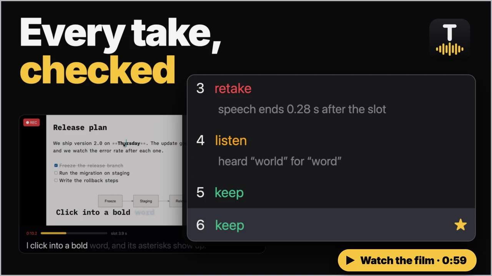
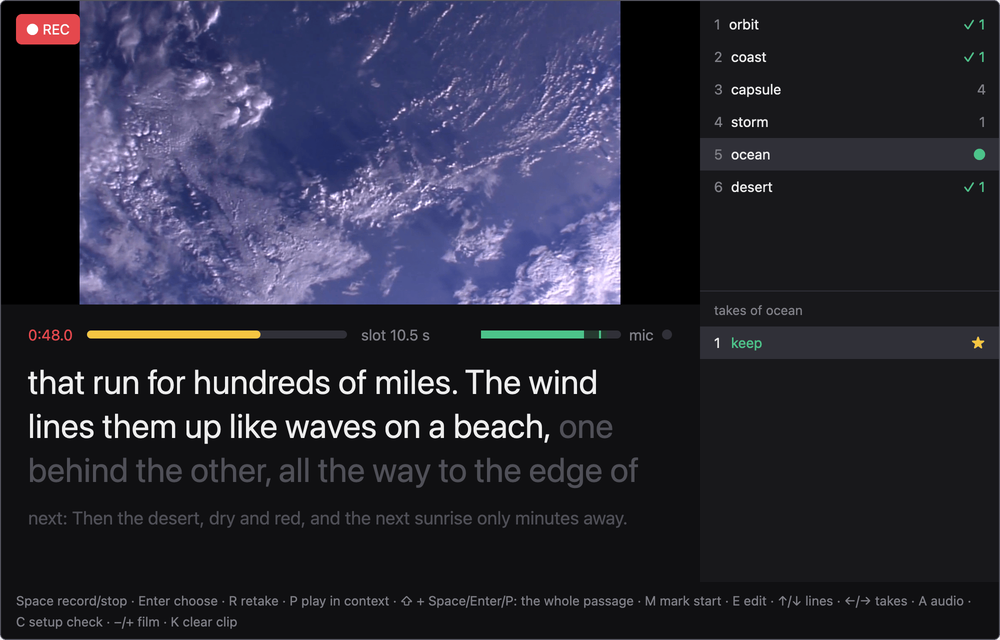
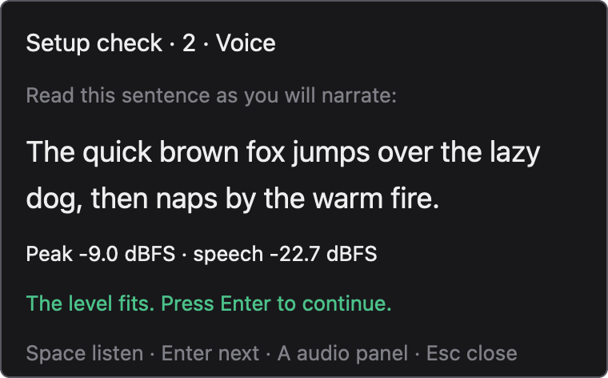
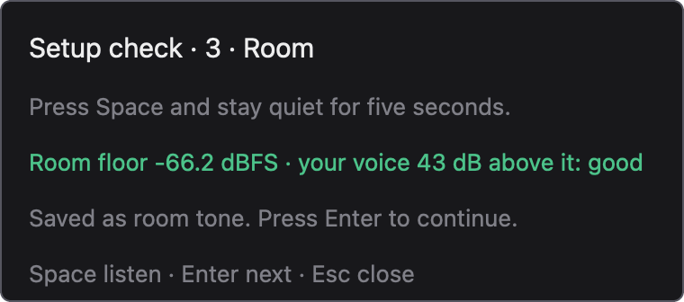
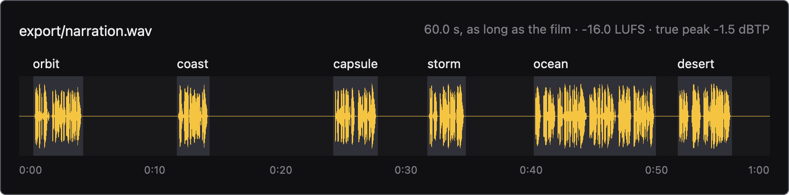

<p align="center"></p>

<h1 align="center">Takewise</h1>

<p align="center"><strong>A Mac app for recording voiceover over a finished film:</strong> read from a teleprompter timed to your cut, catch likely mistakes while you're still at the mic, and bring one synced narration file back into your editor.</p>

<p align="center">macOS 14+ · Apple Silicon · checks run locally · signed and notarized · <a href="LICENSE">MIT</a> · <a href="#install">Install</a></p>


<sub>Two takes of one line at twice their speed. The first comes back `retake · missing “home”`, the second `keep`. The hollow star marks the best checked take that isn't a `retake`; Enter chooses a take and fills it. Demo film: NASA's public-domain "Earth Views from the International Space Station"; takes spoken by macOS `say` and checked by Takewise.</sub>

**[Watch the 59-second film](https://youtu.be/6kujiHjqDhg)** on YouTube: record voiceover to picture on a Mac, every take checked.

[](https://youtu.be/6kujiHjqDhg)

## Why

Narration over a finished cut usually goes into a recorder app, Audition or a phone: one long file, no picture in front of you, the script on another screen. Afterwards you scrub through it for the good take of each line and spot each one onto the timeline by hand. Recording inside the editor gives you the picture, but the script and the retakes still have nowhere to go. Either way the mistakes surface late: a wrong word you only hear while cutting, a line that runs into the next shot, a peak that clipped.

Takewise records one line at a time against the picture, keeps every take, checks each one while you're still at the mic, and hands back a file that already lines up with the film.

## How it works

Takewise is a recording window plus a `takewise` command for everything around it.

1. **Script.** `takewise init` starts a project from the finished film. Its script, `script.toml`, has one entry per line with its start in film time; you write it, or an agent drafts it. Rough starts are fine; you can nudge them while the film plays. A line's *slot* runs from its start to the next line's start (or to an end you set): the time the line has to fit in.
2. **Record to picture.** `takewise record` opens the window. Press Space: the film plays from 3 s before the line, counts in 3-2-1, and the words fill at an even pace across the slot. Space stops the take; otherwise it ends by itself 1.5 s after the slot.
3. **Checks.** After each take, Takewise compares a local whisper.cpp transcript with the script and flags likely word, timing and sound problems: `keep`, `listen` or `retake`, with the reason. Listen back before choosing.
4. **Choose.** The hollow star marks the best checked take that isn't a `retake`; Enter chooses a take. Takewise never chooses for you.
5. **Export.** `takewise export` writes one narration file exactly as long as the film, with each chosen take where it belongs. Line up the file's first sample with the first frame of the cut you imported, in any editor.

## Install

```sh
# Takewise.app, the takewise command, whisper-cpp and ffmpeg
brew install --cask niklas-heer/tap/takewise
# The speech model for the word checks (1.5 GB), once
takewise models install
# Checks the tools, the model, the microphone and the devices
takewise doctor
```

The cask installs `Takewise.app`, the `takewise` command, whisper-cpp and ffmpeg. Takewise needs an Apple Silicon Mac with macOS 14 or later, an audio input that runs at 48 kHz, and wired headphones: film sound from speakers leaks into your takes, and Bluetooth headphones delay the film's sound and aren't supported for recording. The Mac's built-in microphone and its headphone jack are enough for a first try. The app is signed and notarized.

The speech model (`ggml-large-v3-turbo.bin`, 1.5 GB) is downloaded once, from whisper.cpp's repository on Hugging Face and is installed only when its SHA-256 matches the one pinned in Takewise. The recording window offers the same download with a button. After that, nothing needs the network.

macOS asks for microphone access the first time Takewise listens to your input, usually when you pick it in the audio panel. If you said no, turn Takewise on in System Settings › Privacy & Security › Microphone and reopen it.

## Try it on one line

Start a project on your own film, an H.264 or HEVC `.mp4` or `.mov` that plays in QuickTime:

```sh
takewise init demo.takewise --film /path/to/your-cut.mp4
```

Add a first line to `demo.takewise/script.toml`. `start` and `end` are seconds of film time, so this line's slot runs from 4.0 to 8.0 s. Set them to a stretch of your film with room for the sentence, about four seconds and at least 3 s in so the count-in plays over the picture, and `text` to what you will say there:

```toml
[[line]]
id = "first"
start = 4.0
end = 8.0
text = "This is my first line in Takewise."
```

No footage at hand? Fetch the demo film the screenshots use, NASA's public-domain "Earth Views from the International Space Station" (120 MB), cut it to 60 seconds and start the project on that:

```sh
nasa=https://images-assets.nasa.gov/video
clip="Earth%20Views%20from%20the%20International%20Space%20Station"
curl -fLo earth-views.mp4 "$nasa/$clip/$clip~large.mp4"
ffmpeg -ss 16 -t 60 -i earth-views.mp4 -c:v libx264 -c:a aac film.mp4
takewise init demo.takewise --film film.mp4
```

On the demo film, add this line instead; from 25.0 to 29.1 s the film shows a capsule docked at the station:

```toml
[[line]]
id = "capsule"
start = 25.0
end = 29.1
text = "A capsule waits at its port, ready to bring the crew home."
```

Open the recording window:

```sh
takewise record demo.takewise
```

1. **Pick your devices** in the audio panel. It opens by itself on a new project, since no input is chosen yet; A opens it otherwise. Pick your microphone's input (macOS asks for microphone access now), speak, and pick the channel whose meter moves. Then pick the output your headphones are on. If the panel offers **Switch to 48 kHz**, use it. Press A to close the panel.
2. **Recommended: press C** for the setup check: your voice level, the room tone, and the latency, measured with your headphones held to the microphone. Enter goes on, Space starts each measurement, and Enter finishes. Without it, Space records all the same, but takes are placed without a latency correction and the export skips noise reduction.
3. **Press Space** to record. The film starts 3 s before the line (`[record] preroll_s`; projects made before 0.1.2 keep 2 s) and counts in 3-2-1; read as the words fill. Space stops the take, or it ends by itself 1.5 s after the slot.
4. **Wait for the verdict.** "checking…" turns into `keep`, `listen` or `retake`, with the reason.
5. **Press P** to play the take back with the film.
6. **Press R or Enter.** If the check flags a problem you hear on playback, press R and try again; otherwise press Enter to choose it. Then close the window.

Then export:

```sh
takewise export demo.takewise
```

The narration is `demo.takewise/export/narration.wav`, with `export/manifest.json` beside it. To watch the line on its shot, put the narration on the film (with your film's path in place of `film.mp4`):

```sh
ffmpeg -i film.mp4 -i demo.takewise/export/narration.wav \
  -map 0:v -map 1:a -c:v copy check.mp4 && open check.mp4
```

`check.mp4` is the film with your narration as its only sound: silent until the slot, then your take over its shot.

Opened from the Dock or Finder, `Takewise.app` shows a start window instead: **Open project…** (⌘O) and your recent projects ([details](docs/reference.md#the-start-window)). Lines are still added in `script.toml`, and export is still the `takewise export` command. [The script format](docs/design.md#project-folder) has the optional fields, such as a `note` for the narrator.

## What it does

### Reading to picture

<p align="center"><br><sub>A long line during a take: it has scrolled up a row, so the current words stay in the middle.</sub></p>

The window shows the film, the line to read, its note for the narrator and the next line. A bar shows the slot running out. A line longer than three rows scrolls with the pace guide. E fixes a line's wording in place.

### Passages: sentences that run on

Read one line at a time, each sentence gets its own count-in and loses the intonation that joins it to the next. So lines that follow each other closely form a *passage*, and you can read a passage in one go.

- **Shift+Space** records from the current line through the end of its passage: one take, one count-in. The prompter moves to each line when the film reaches its start, and the take stops by itself 1.5 s after the last line's slot, or when you press Space.
- The recording is kept whole and cut, in the pauses between the sentences, into one take per line. Each of those is checked, chosen and replaced like any other take, so you can still pick up a single line with Space. The cuts follow the cues within about a second, so missing or extra words on both sides of a cut after a passage take mean the read ran off the cues there; the passage file itself is intact (Shift+P plays it, and a passage chosen whole exports as you read it).
- **Shift+P** plays the whole passage against the film, so you hear the flow. **Shift+Enter** chooses the passage for every line it has a take of.
- The export keeps chosen takes of one passage together, as you read them: the breaths and pauses between the sentences stay, and only the passage's outer edges are trimmed. A line you picked up on its own is spliced in as any take is.

Which lines belong together is a rule, not a setting per line: a line joins the one before it when it starts less than `[record] passage_gap_s` (1.0 s) after that line's slot ends. Sentences a few tenths of a second apart are grouped, and a deliberate pause for the picture or the music ends the passage. The line list shows each passage with a thin bar beside its lines.

### Every take checked

<p align="center"><br><sub>The capsule line's takes, take 4 chosen.</sub></p>

After each take, on your Mac:

- **Words.** whisper.cpp transcribes the take without being shown the script, so it doesn't hear what it expects. Missing or extra words give `retake`. A word heard differently, such as “dock” for “port”, gives `listen`, because names and numbers are often misheard.
- **Timing.** Speech that ends more than 0.25 s after the slot, or starts more than 0.3 s before the line, gives `retake`.
- **Sound.** No speech or clipped samples give `retake`. If Whisper marks a cough or another sound inside the speech, Takewise flags the take with `listen`; so does a voice less than 30 dB above the background noise, measured in the take's pre-roll before you speak.

The first finding is the reason shown under the take. These are automated checks with limits: P plays the line in context, the take locked to the film, so you can listen before you choose. The word checks default to English; `[check] language` in `project.toml` takes any Whisper language code, but the matching of numbers and contractions is tuned for English. Until the speech model is installed, takes get `listen` ("words not checked") while timing and sound can still give `retake`, and their words are checked once it is there.

### Pick the microphone, watch the level

<p align="center"><br><sub>The audio panel, and a peak near clipping.</sub></p>

Press A for the audio panel. Pick the input and the channel your microphone is on: every channel has its own meter, so the one that moves is yours. Then pick the output the film plays through and set the film's volume. The input meter shows a target band and a near-clipping light that stays red until you clear it with K or start the next take.

Takewise records at 48 kHz from an input running at that rate. For an input set to another rate, the panel offers **Switch to 48 kHz**.

### A setup check before the first take

<p align="center"> <br><sub>The setup check's voice and room steps, each with its result.</sub></p>

Press C, and Takewise walks you through your devices, flagging speakers and Bluetooth headphones. Then it listens while you read a sentence and tells you how far to turn the gain on your interface. Next it records five seconds of silence and rates how far your voice stands above the room's noise; that recording is kept as room tone for the export's noise reduction. When the latency hasn't been measured for these devices, a last step does it: hold your headphones against the microphone and press Space, and beeps play for about 15 seconds while Takewise measures where they land (`takewise calibrate --write` does the same from the command line).

Takewise remembers both for your next project. A latency measured on exactly the same input, output and buffer size is reused, and the panel says it came from an earlier measurement. A setup check from today on the same devices is adopted with its room tone. On Bluetooth headphones, whose delay can change after reconnecting, press C to measure again if takes sound late.

### Export for your editor

<p align="center"><br><sub>The demo's export, its takes spoken by macOS <code>say</code>: one file as long as the film, each line's take where <code>export/manifest.json</code> places it.</sub></p>

`takewise export` writes `export/narration.wav` (or FLAC): one mono file that starts at the film's first frame and is exactly as long as the film. Each chosen take is placed at its line's current start plus the offset it was recorded at, and trimmed to its detected speech with a short margin, so moving a line's start moves its take with it. Beside the file, `export/manifest.json` lists each line's sample positions, words and timings, for an agent or script that adds markers or places takes one by one.

The default `clean` processing high-passes each take and reduces its noise when a matching room tone from the setup check exists. It then brings the narration to −16 LUFS, a common level for spoken word, with true peaks below −1 dBTP, and records the measured loudness and peak in the manifest. The limiter takes at most 6 dB, so very dynamic narration can stay below the target; the export warns when that happens. Your takes themselves are never changed.

By default every line needs a chosen take; `--use-proposed` fills unchosen lines with their proposed take, and still refuses a line whose proposed take is marked `retake`. The export also refuses when a take it uses has no detectable speech or two takes' speech overlaps in the film. It names the lines, so the mistake doesn't reach the edit.

## Working with an agent

> *"My cut is `renders/promo.mp4` and the voiceover draft is in `notes.md`. Set up a Takewise project with each line timed to its shot. I'll record; then tell me which lines to redo, export, and put the narration on the Resolve timeline."*

You stay at the mic. An agent can draft the script, read line and take status as JSON, judge and choose takes if you hand that over, and export; with access to your editor it can place the narration there too. It works through the `takewise` command (`--json` on any command) and the project folder (plain TOML, JSONL and WAV), never the window. To time the lines it needs its own view of the cut, such as frames pulled with `ffmpeg` or the editor's timeline through its own tools; Takewise doesn't provide one.

```console
$ takewise status earth.takewise
earth.takewise  ·  film 60.0 s  ·  6 line(s)
orbit           1 take(s)  chosen 1 (narrator)   proposed 1  keep
coast           1 take(s)  chosen 1 (narrator)   proposed 1  keep
capsule         4 take(s)  chosen 4 (narrator)   proposed 4  keep
storm           1 take(s)  chosen –              proposed 1  keep
ocean           1 take(s)  chosen 1 (narrator)   proposed 1  keep
desert          1 take(s)  chosen 1 (narrator)   proposed 1  keep
$ takewise judge earth.takewise storm 1 --verdict keep \
    --reason "clear, unhurried" --by claude-opus-5-5 --score 0.8
Judged storm take 1: keep
$ takewise choose earth.takewise storm 1 --by claude-opus-5-5
Chose storm take 1 (claude-opus-5-5)
$ takewise export earth.takewise
```

The export then reports `Wrote earth.takewise/export/narration.wav (6 line(s)): clean 48000 Hz 24-bit wav, -16.0 LUFS, true peak -1.5 dBTP`. This is the demo project of the screenshots, takes spoken by macOS `say`; `mise run screenshots` runs these commands on a copy of it.

[docs/agents.md](docs/agents.md) is the agent's guide: the whole loop with the exact commands and JSON. A test runs the guide's commands in order on a scratch project, with fixture takes in place of the narrator's `takewise record`, and checks that every JSON example has the shape of the real output.

## Placing the narration in your editor

The narration file starts at the film's first frame and is exactly as long as the film. In any editor, put it on a mono track at the start of the timeline that holds the cut you imported, so the file's first sample lines up with the cut's first frame. Takewise has no editor-specific code. In DaVinci Resolve, for example, you or an agent with Resolve tools would:

1. Import the file named in the manifest's `narration.file` into the media pool.
2. Add a mono audio track to the film's timeline and place the file at the timeline's start.
3. Optionally add a marker for each entry under `lines` in `export/manifest.json`, at `speech_film_s[0]`, named after the line's `id`.

To place each take on its own instead, see [placing takes one by one](docs/agents.md#7-place-it-in-the-edit).

## Keys

| Key | Does |
| --- | --- |
| Space | Record a take of the current line, or stop a take (it also stops by itself 1.5 s after the slot) |
| Shift+Space | Record from the current line through the end of its passage as one take, or stop a take |
| Enter | Choose the selected take |
| Shift+Enter | Choose the selected take's passage for every line it has a take of |
| R | Record another take of the current line |
| P | Play the line in context, the selected take locked to the film (needs a take) |
| Shift+P | Play the selected take's whole passage, locked to the film |
| M | Set the line's start to the playhead while the film plays (during a take of one line, or P) |
| E | Edit the line's text (Enter saves, Esc cancels) |
| ↑ / ↓ | Previous or next line |
| ← / → | Previous or next take |
| A | The audio panel: input, channel, output, volume, meters |
| C | The setup check |
| − / + | Film quieter or louder |
| K | Clear the clipping light |
| I | Install the speech model, while it is missing |

H and the monitor volume keys (`,` and `.`) belong to monitoring, which isn't available yet.

## Status

0.1.3 is an early release. The check thresholds were tuned on eight lines of real narration recorded, outside Takewise, for an earlier film, and the clean export was measured on them (−16.0 LUFS, −1.5 dBTP). Since then, two full sessions were recorded in Takewise on a RØDECaster Duo, the voiceovers of two promo films: Focal's (7 lines, 15 takes, on 0.1.1) and Takewise's own (8 lines, 21 takes, on 0.1.2). Both projects name a Bluetooth headset as the output, the setup this README advises against, so a session with wired headphones is still to come. Both clean exports came out slightly short of −16 LUFS (−16.6 and −16.7, at −1.5 dBTP), as the export warned. The Focal session also showed that the count-in couldn't be read over a light film; 0.1.3 puts its digit on a dark plate. Automated tests use synthetic speech and simulated devices. Not yet:

- **Hearing your own voice through Takewise.** Use your interface's direct (hardware) monitoring.
- **Writing the script inside the app.** In the window, E edits a line's text and M its start; new lines go into `script.toml`.
- **Exporting from the window.** Export is the `takewise export` command.

If something doesn't work with your setup, please [open an issue](https://github.com/niklas-heer/takewise/issues).

## Reference

- [docs/reference.md](docs/reference.md): every command and its options, exit codes and refusals, the export formats and processing, recording passages, the audio panel, the setup check step by step, building from source, and how the screenshots are made.
- [docs/agents.md](docs/agents.md): an agent's full loop with the exact commands and JSON.
- [docs/design.md](docs/design.md): the design, the folder format and the reasons behind them.

### From source

With Rust (pinned in `rust-toolchain.toml`) and [mise](https://mise.jdx.dev): `mise run build`, `mise run check`, and `mise run bundle` for `build/Takewise.app`, which recording needs for the microphone permission. See [building from source](docs/reference.md#building-from-source) for the details, and [RELEASE.md](RELEASE.md) for releases. `mise run screenshots` renders every image in this README offscreen ([how](docs/reference.md#regenerating-the-screenshots)).

## License

[MIT](LICENSE)
